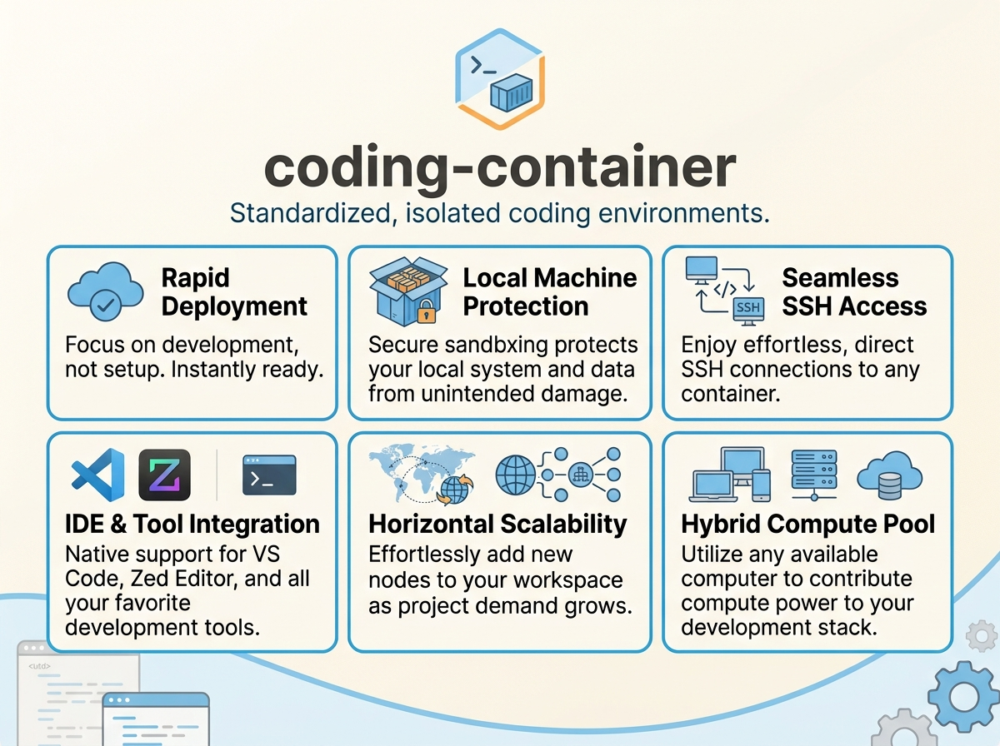
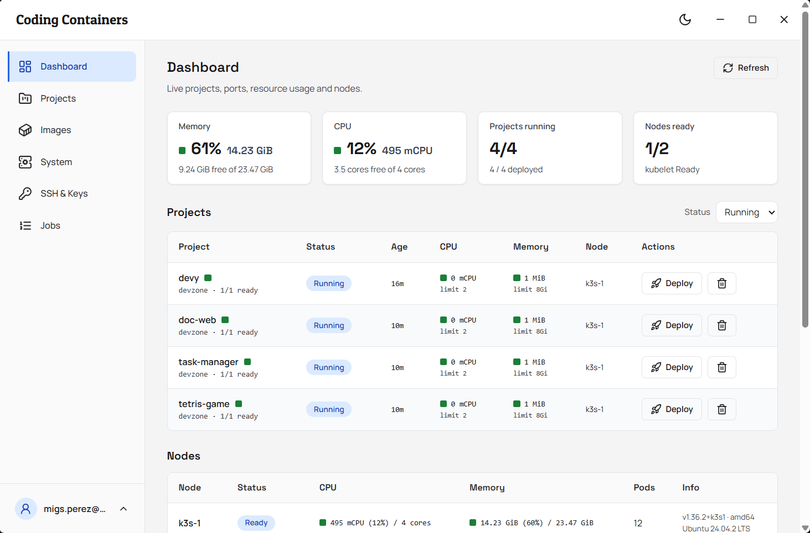
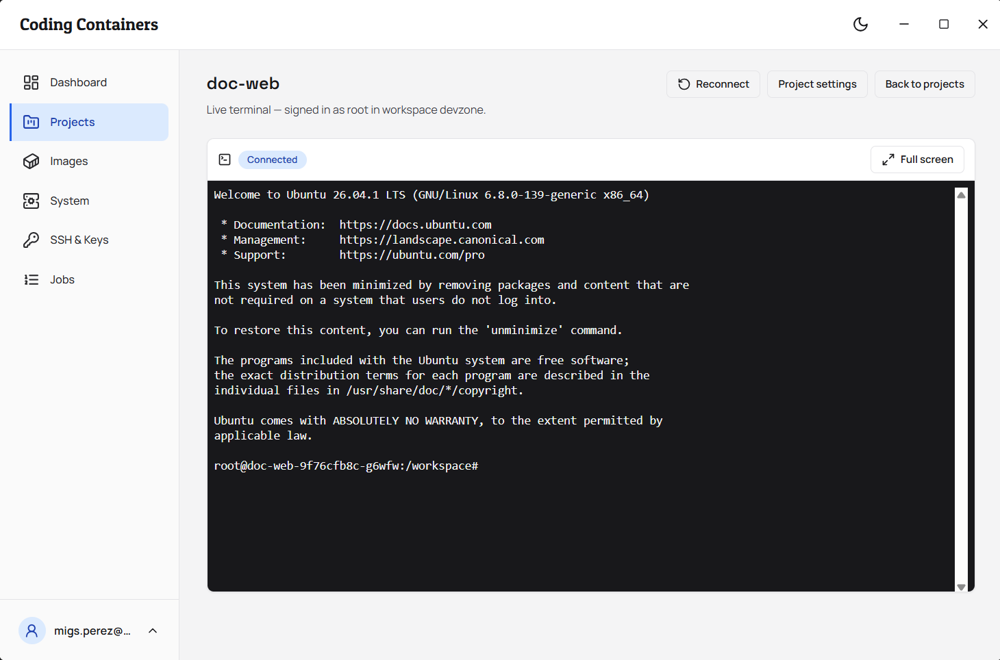
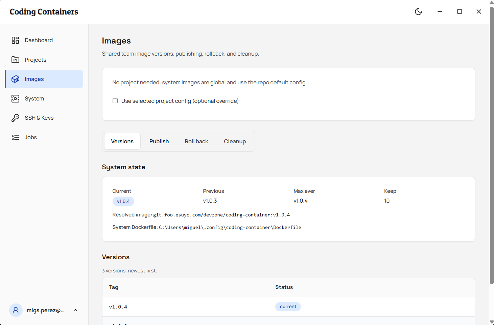
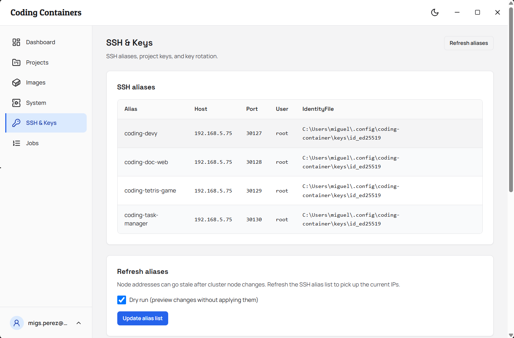

# coding-container

> Ready to code containers on your Kubernetes cluster, per project, with workspaces that keep your work.

`coding-container` gives every project its own consistent coding environment on Kubernetes. You open the app, add a project, press Deploy, and land in `/workspace` backed by your NAS so work survives restarts. The default image starts with Ubuntu, Node.js, and common dev tools. The Dockerfile is yours to change for any language or toolchain, with optional sidecars for databases and queues.

Use it in the browser or in the installable desktop app. Both show the same projects, images, and jobs. The desktop app wraps the same pages in a window with encrypted sign in and automatic updates. Pick the one you like. They stay in sync through one shared registry on your machine.

For private, internal Kubernetes clusters only. Do not expose to the public web. Every project opens NodePorts on all cluster nodes with SSH plus optional web and sidecar ports, and serves Ingress hosts without auth or TLS by default. Only run this on a trusted internal network such as a homelab, LAN, or VPN gated cluster behind a firewall. See [Architecture](./docs/architecture.md#security-notes) for details.

<table>
  <tr>
    <td colspan="3"></td>
  </tr>
  <tr>
    <td></td>
    <td></td>
    <td></td>
  </tr>
</table>

## Features

* One Deploy press for a ready to code container, with removal when done
* Kubernetes native: Deployment, Service, Ingress, ConfigMap, and Secret applied for you
* Persistent per project workspace on your NAS, so files survive restarts
* SSH alias per project, ready for VS Code Remote SSH and for the browser terminal
* Optional browser access to dev servers and sidecars for databases and queues
* Shared team image with versioning, or a custom image per project, with your own Dockerfile for any language or toolchain
* Browser pages: dashboard with live workload status, project editor with checks, terminal in the browser, image publishing, and a job log for every task
* Desktop app for Windows, macOS, and Linux: the same pages in an installable window with encrypted sign in and automatic updates
* Shared project registry, so the browser and desktop views stay in sync

## Prerequisites

* A private, internal Kubernetes cluster with any conformant distribution and `kubectl` access. Do not use a publicly exposed cluster
* Node.js 18 or newer, Docker, `kubectl` on PATH
* `docker login` to your container registry
* OpenSSH with `ssh` and `ssh-keygen`
* Your NAS reachable from the cluster nodes
* For sign in: an email and password you create on first launch in the app

## Installation

Start with the desktop app when you can. It is the simplest path.

**Desktop app:**

Download an installer from the releases page and run it like any other app. Sign in once on first launch. The dashboard opens from then on, with sign in kept in the OS keychain. See [Desktop](./docs/desktop.md).

To build from source:

```sh
npm --prefix web/client run build
npm --prefix electron install
npm --prefix electron run dist:win
```

Use `dist:mac` on macOS and `dist:linux` on Linux. See [Desktop](./docs/desktop.md) for all targets.

**Browser pages from source:**

```sh
npm --prefix web/client install
copy .env.example .env
node web/dev.js
```

Use `cp .env.example .env` on macOS or Linux in place of `copy`. Then open the pages and create your sign in on the computer that runs the server.

```sh
npm --prefix web/client run build
node web/server/server.js
```

The first build line emits `web/client/dist`. The second serves the pages and the API together on one port. See [Web GUI](./docs/gui.md).

The pages run on `:3400` in dev with the API on the `.env` `PORT`, default `3401`. Production serves both on the `.env` `PORT`.

To stop orphaned dev servers that still hold the dev ports:

```sh
node web/kill-dev.js
```

## Configuration

Two small YAML files drive everything: a shared config for your environment at `~/.config/coding-container/config.yaml`, and a project `config.yaml` for what differs per project.

You rarely edit these by hand. Open the Setup page to create the shared config, and open a project to edit its YAML with checks and a manifest preview.

```yaml
project: my-project
k8s:
  nodePort: 30022
```

Each checkout carries its own identity in a `.env` file copied from `.env.example`: separate config folders, connection alias prefixes, and namespaces for isolated dev and prod instances, plus server settings like the app port. This file is not for project variables. Project values live in each project `config.yaml`, with secrets supplied as shell variables and referenced as `${NAME}`.

See [Configuration](./docs/configuration.md) for layering, many projects, the shared registry, and NAS folders. See [Environment variables and secrets](./docs/env-and-secrets.md) for plain values plus secret handling.

## Quick Start

1. Open the app and create your sign in when asked. On a new machine this is a create account form. On your own machine only.
2. Open the Setup page. Fill in container registry, NFS server, and NFS base path. Press Run setup and follow the job on the Jobs page.
3. On a fresh cluster, open the System page once and press Initialize system with a starting tag such as `v1.0.0`. Then open the Images page and press Publish new version.
4. Open the Projects page, add a project, open it, and press Deploy. The Dashboard shows live status while it rolls out.
5. Press Terminal on the project page to land in `/workspace`. Or connect VS Code Remote SSH to `coding-<project>` and open `/workspace`.

For the full flow with checks and logs, see [Web GUI](./docs/gui.md). For Windows with K3s from scratch, see [Windows setup](./docs/windows-setup.md). For the browser terminal and VS Code, see [SSH and VS Code](./docs/ssh-and-vscode.md).

To stop a session, close the browser tab or type `exit` in the terminal. To remove a project, use Remove on the project row or project page and confirm. Files on the NAS stay safe.

To verify it works, the Dashboard row for your project reads Running, the Jobs page shows the deploy as done, and Terminal opens in `/workspace`.

If you prefer a shell on this machine for the same tasks, see [Terminal use](./docs/cli-reference.md). The app remains the primary path.

## Troubleshooting

* **Setup page says values are missing?** Fill in registry, NFS server, and base path, then press Run setup again.
* **Push or publish reports auth trouble?** Run `docker login <your-registry>` first, then try again.
* **Pod stuck?** Usually NFS or image pull. Open the Jobs log for the deploy, then see [Troubleshooting](./docs/troubleshooting.md).
* **Cannot sign in?** Create the account on the computer that runs the server. Remote addresses cannot register on purpose. If you use an older `.env` with `ADMIN_EMAIL` and `ADMIN_PASSWORD`, the server moves those into its credential file on first start.
* **Pages show GUI not built?** Run `npm --prefix web/client run build` first, then restart the server.

## License

MIT. See [LICENSE](./LICENSE).

## Developer Documentation

* [Web GUI](./docs/gui.md), pages, jobs and server settings
* [Desktop app](./docs/desktop.md), installable shell around the pages
* [Build and Deployment](./docs/build-and-deployment.md), npm releases, GUI bundle and installers
* [Configuration](./docs/configuration.md), config layering, many projects and NAS volumes
* [Environment variables and secrets](./docs/env-and-secrets.md), plain values plus secret handling with shell variables
* [Shared global image](./docs/global-image.md), team image versions, publishing, rollback and cleanup
* [Web access](./docs/web-access.md), browser access to dev servers with Traefik
* [Sidecars](./docs/sidecars.md), databases, queues and other pod companions
* [Terminal use](./docs/cli-reference.md), optional shell path with all tasks from a prompt
* [SSH and VS Code](./docs/ssh-and-vscode.md), key rotation and Remote SSH setup
* [SSH image paste](./docs/ssh-image-paste.md), clipboard images into opencode over SSH
* [Troubleshooting](./docs/troubleshooting.md), common failures and fixes
* [Architecture](./docs/architecture.md), tech stack and system design
* [Project Structure](./docs/project-structure.md), folder layout
* [Development Guide](./docs/development.md), local setup for contributors
* [App config and setup files](./docs/config-files.md), persisting tool configs with `/workspace`
* [Windows setup](./docs/windows-setup.md), Docker, kubectl, K3s, registry and kubeconfig on Windows
* [Plan: Additional NFS volumes](./docs/build/additional-volumes.md), design history for extra volumes
* [Plan: Public prebuilt images](./docs/build/public-images.md), design history for public images
